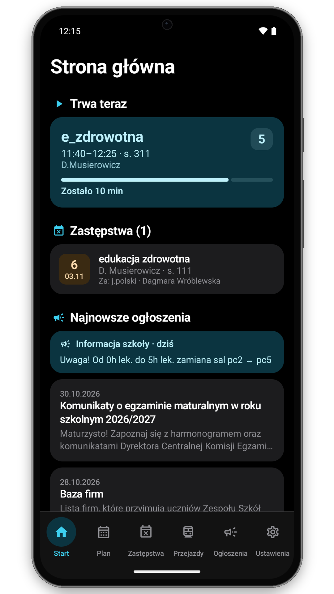
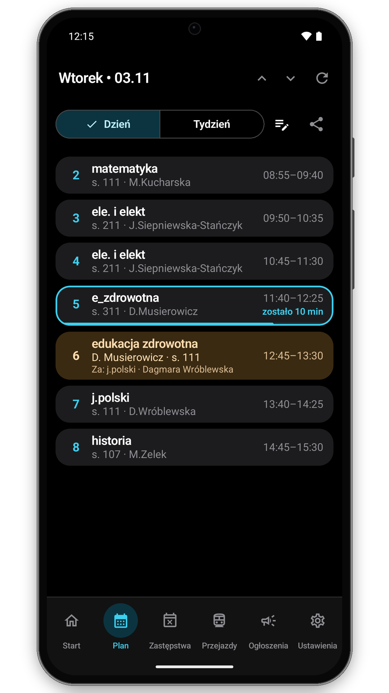
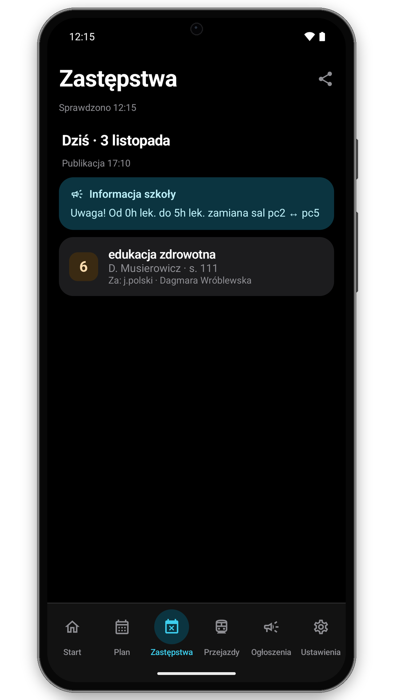
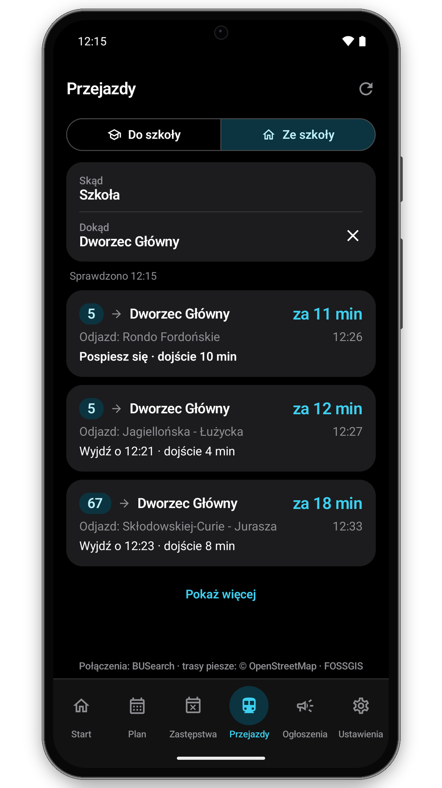
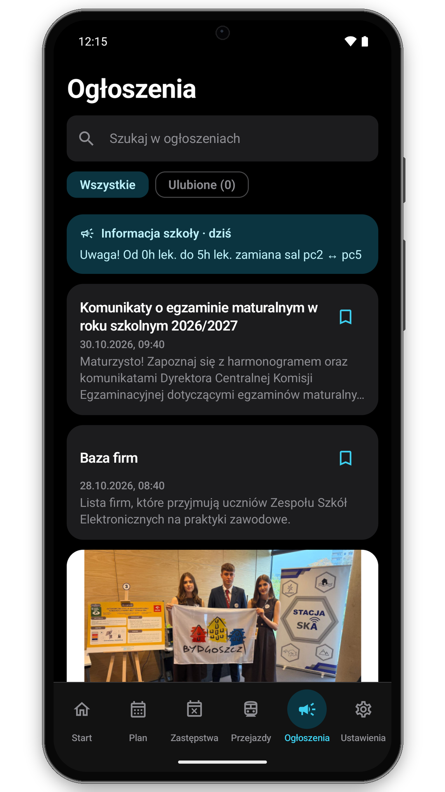
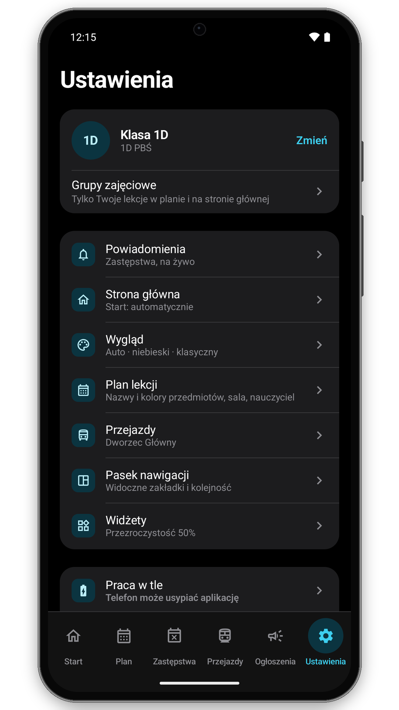
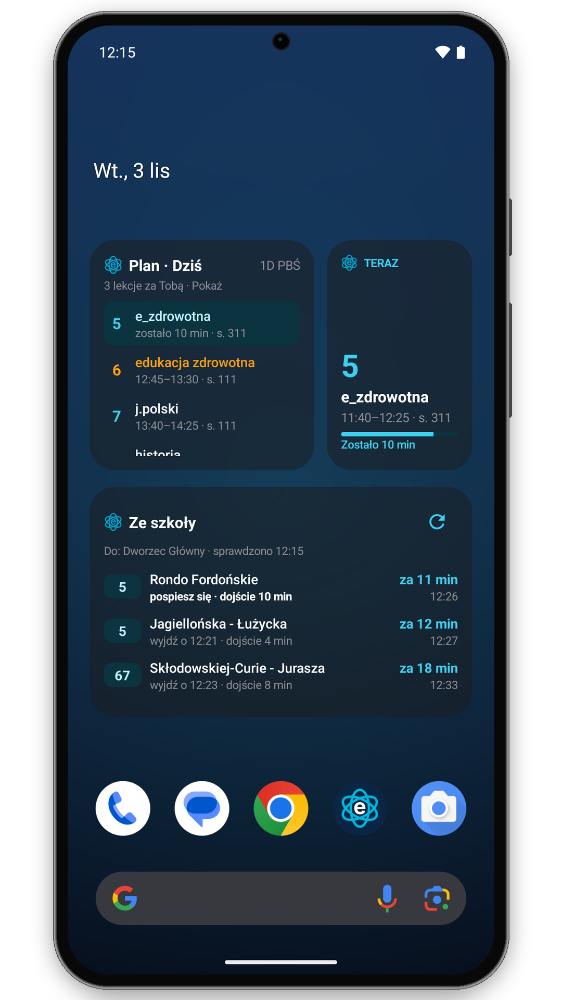
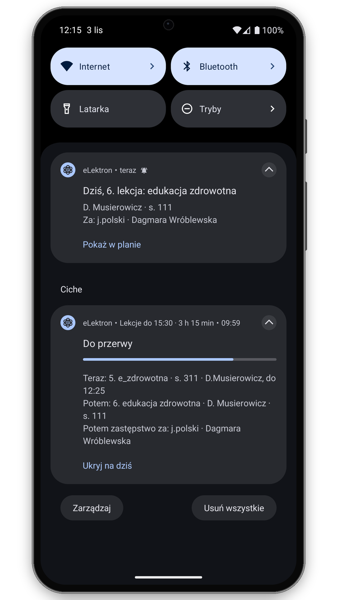

<div align="center">


# eLektron

**Plan lekcji, zastępstwa, ogłoszenia i przejazdy do szkoły i ze szkoły w jednej aplikacji na Androida dla uczniów ZSE w Bydgoszczy.**

[](https://github.com/stasolejnik/elektron/releases)
[](https://github.com/stasolejnik/elektron/actions/workflows/ci.yml)
[](LICENSE)


### [Pobierz eLektron 1.0.3 (.apk)](https://github.com/stasolejnik/elektron/releases/download/v1.0.3/eLektron-1.0.3.apk)

Zalecane, z powiadomieniami push.

<sub>Albo z F-Droid, bez usług Google:</sub><br>
<a href="https://f-droid.org/pl/packages/pl.zse.bydgoszcz.elektron/"></a>

</div>

## O aplikacji

eLektron zbiera informacje potrzebne w szkolnym dniu: plan Twojej klasy i grup, zastępstwa,
ogłoszenia oraz połączenia komunikacji miejskiej między Twoim przystankiem a szkołą. Nie wymaga
konta, a pobrane dane szkolne i ulubione ogłoszenia działają bez internetu.

To nieoficjalny projekt ucznia, niezwiązany ze szkołą ani z firmą VULCAN. Aplikacja jest
inspirowana [Atomem](https://github.com/kacpergorka/atom) [Kacpra Górki](https://github.com/kacpergorka)
na urządzenia Apple, ale została napisana od podstaw i nie zawiera jego kodu.
Kod tworzą Claude (Anthropic) i ChatGPT (OpenAI); ja wybieram funkcje i testuję aplikację.

## Zrzuty ekranu

<p align="center">
  
  
  
  
</p>
<p align="center">
  
  
  
  
</p>

## Funkcje

- **Plan lekcji:** dzień i tydzień z zastępstwami, Twoje grupy zajęciowe, notatki do lekcji z przypomnieniem.
- **Zastępstwa:** zmiany dla Twojej klasy i grup oraz informacje szkoły (np. skrócone lekcje).
- **Ogłoszenia:** wyszukiwanie, czytanie w aplikacji i ulubione do odczytu bez internetu.
- **Przejazdy:** autobusy i tramwaje rano do szkoły (ile zapasu do lekcji) i po lekcjach ze szkoły,
  opóźnienia na żywo i pozycja pojazdu na mapie. Bez GPS.
- **Strona główna:** trwająca lub najbliższa lekcja, kolejna lekcja, zastępstwa, dojazd i ogłoszenia.
- **Powiadomienia:** zastępstwa, ogłoszenia, przypomnienia o lekcjach i notatkach oraz powiadomienie
  na żywo z odliczaniem do końca lekcji (także na pasku stanu w Androidzie 16).
- **Szybki dostęp:** widżety Teraz, Plan dnia, Zastępstwa i Przejazdy, kafelek szybkich ustawień,
  skróty ikony i opcjonalny przycisk „Więcej” na dolnym pasku.
- **Wygląd:** motyw, kolor akcentu i tła, kolory z tapety, własne nazwy i kolory przedmiotów, dwie ikony aplikacji.

Jak korzystać z aplikacji i co zrobić, gdy coś nie działa: **[INSTRUKCJA.md](INSTRUKCJA.md)**.

## Instalacja

**Z GitHuba (zalecane):** pobierz [eLektron-1.0.3.apk](https://github.com/stasolejnik/elektron/releases/download/v1.0.3/eLektron-1.0.3.apk)
([wszystkie wydania](https://github.com/stasolejnik/elektron/releases)), otwórz plik na telefonie
i zezwól na instalację z tego źródła. Ta wersja ma powiadomienia push o zastępstwach i aktualizacje w aplikacji.

**Z F-Droid:** [strona aplikacji](https://f-droid.org/pl/packages/pl.zse.bydgoszcz.elektron/). Bez usług
Google - o zastępstwach dowiaduje się z okresowego sprawdzania w tle; aktualizacje kilka dni po GitHubie.

Wymaga **Androida 8.0 lub nowszego**. Nowe wersje instaluj na wierzch poprzedniej - ustawienia,
notatki i ulubione zostają. Wersji z GitHuba i z F-Droid nie da się zainstalować jedna na drugą
(inne podpisy); zmiana źródła wymaga odinstalowania.

## Prywatność

Bez konta, reklam i analityki. Ustawienia, notatki i przystanki są tylko na telefonie, a Przejazdy
nie korzystają z GPS. Szczegóły wszystkich połączeń (strony szkoły, BUSearch, OpenStreetMap, w wersji
z GitHuba także Firebase i GitHub): [PRYWATNOSC.md](PRYWATNOSC.md).

## Zgłaszanie problemów

W **Ustawieniach → O aplikacji → Zgłoś problem** przygotujesz raport z wersją aplikacji, telefonem
i ostatnimi logami. Opisz problem w [Issues](https://github.com/stasolejnik/elektron/issues)
albo napisz na [elektron@tuta.com](mailto:elektron@tuta.com).

## Dla osób rozwijających projekt

Kotlin, Jetpack Compose, Glance, Room, DataStore, Hilt, WorkManager, OkHttp, Jsoup i osmdroid; minSdk 26.
Dwa warianty: `gms` (GitHub, powiadomienia FCM, aktualizacje w aplikacji) i `foss` (F-Droid, bez usług Google).

```sh
./gradlew :app:testFossDebugUnitTest :app:assembleFossDebug
```

Budowanie, wydania, powiadomienia push, zmiany stron szkoły i API BUSearch, rozwiązywanie problemów:
**[DEWELOPER.md](DEWELOPER.md)**. Historia zmian: [CHANGELOG.md](CHANGELOG.md).

## Źródła danych

| Dane | Źródło |
|---|---|
| Plan lekcji i lista klas | [plan.zse.bydgoszcz.pl](https://plan.zse.bydgoszcz.pl) |
| Zastępstwa | [zastepstwa.zse.bydgoszcz.pl](https://zastepstwa.zse.bydgoszcz.pl) |
| Ogłoszenia | [zse.bydgoszcz.pl](https://zse.bydgoszcz.pl) |
| Przystanki, połączenia i pojazdy na żywo | [BUSearch Bydgoszcz](https://busearch.pl/bydgoszcz) (Szymon Czaja) |
| Mapa | [OpenStreetMap](https://www.openstreetmap.org/copyright) |

## Licencja

Copyright © 2026 Stanisław Olejnik.

eLektron jest wolnym oprogramowaniem na licencji [GNU GPL](LICENSE) w wersji 3 lub
późniejszej. Podziękowania i informacje o zależnościach: [NOTICE](NOTICE).
